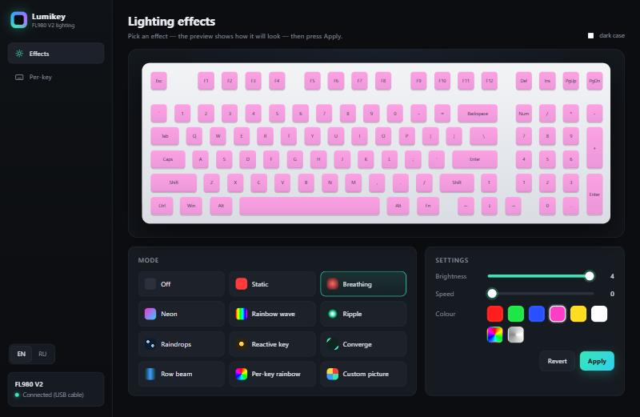

# Lumikey

**Lighting control for the FL-ESPORTS FL980 V2 keyboard — no official driver required.**

[Русская версия](README.ru.md)



Lumikey is a small Windows app that talks to the FL980 V2 directly over USB HID. It lets you pick lighting effects with a live preview and paint every key in its own colour.

## Features

- **12 effects**: off, static, breathing, neon, rainbow wave, ripple, raindrops, reactive key, converge, row beam, per-key rainbow, custom picture.
- **Live preview** of every effect on an accurate model of the keyboard, including reactive modes that respond to your real key presses.
- **Brightness, speed and colour**: 6 preset colours, rainbow where the firmware supports it, and any custom RGB colour.
- **Per-key painting**: brush, eraser and colour picker. Drag across keys to paint many at once. Includes rainbow, gradient and WASD presets and 3 picture slots stored on the keyboard.
- **Picture history**: the last 20 versions of each slot are kept automatically.
- **English and Russian** interface.
- **One small `.exe`** (~80 KB). Nothing to install: it uses .NET Framework 4, which ships with Windows 10/11.

## Requirements

- Windows 10 or 11.
- Google Chrome or Microsoft Edge. Lumikey opens its UI in a standalone app window.
- FL980 V2 connected **with the USB cable**. The 2.4 GHz receiver and Bluetooth don't pass lighting commands.

## Usage

1. Download `Lumikey.exe` from [Releases](../../releases) and run it.
2. The app window opens and a tray icon appears. Double-click the tray icon to reopen the window, or right-click it → **Exit**.
3. **Effects**: choose a mode, colour, brightness and speed, then press **Apply**.
4. **Per-key**: paint the keys and press **Upload to keyboard**. The keyboard switches to *Custom picture* mode.

Lumikey closes itself about 20 seconds after you close its window. Pictures are saved in `%APPDATA%\Lumikey`.

> Windows SmartScreen may warn about an unknown publisher, because the exe is not code-signed. You can build it yourself from source (below).

## Building from source

No SDK is needed. The build uses the C# compiler that comes with .NET Framework 4.x:

```bat
build.bat
```

The output is `bin\Lumikey.exe`. The app is a single source file, [`src/Lumikey.cs`](src/Lumikey.cs). The UI is [`src/ui/index.html`](src/ui/index.html), which is embedded into the exe.

## How it works

- The keyboard (USB `05AC:024F`, SONiX MCU, RongYuan "k68" firmware family) accepts 64-byte HID feature reports on its keyboard interface.
- Lumikey runs a tiny HTTP server on `127.0.0.1`. The UI talks to it with a random per-run token, so other web pages can't drive the keyboard.
- Opcodes that could erase flash, reboot into the bootloader or factory-reset the keyboard are blocked in code.

The full protocol write-up is in [docs/PROTOCOL.md](docs/PROTOCOL.md).

## Disclaimer

Lumikey is an independent project. It is not affiliated with or endorsed by FL-ESPORTS. FL-ESPORTS and FL980 are trademarks of their respective owners. Use at your own risk. Lumikey only uses the lighting commands documented here, but the authors take no responsibility for any damage.

## License

[MIT](LICENSE)
