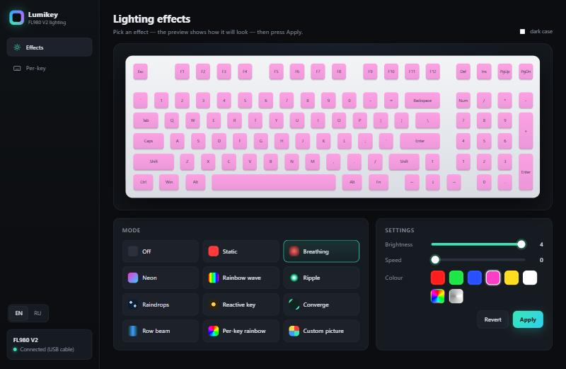

# Lumikey

**Управление подсветкой клавиатуры FL-ESPORTS FL980 V2 без официального драйвера.**

[English version](README.md)



Lumikey — маленькое приложение для Windows. Оно общается с FL980 V2 напрямую по USB HID: выбираешь эффект подсветки с живым предпросмотром или раскрашиваешь каждую клавишу своим цветом.

## Возможности

- **12 эффектов**: выключено, статичный, дыхание, неон, радужная волна, рябь от клавиши, капли, нажатая клавиша, схождение, луч по ряду, радуга по клавишам, свой рисунок.
- **Живой предпросмотр** на точной модели клавиатуры. Реактивные режимы реагируют на твои настоящие нажатия.
- **Яркость, скорость и цвет**: 6 готовых цветов, радуга (где её поддерживает прошивка) и любой свой RGB-цвет.
- **Рисование по клавишам**: кисть, ластик и пипетка. Если вести мышью с зажатой кнопкой, красятся все клавиши по пути. Есть заготовки (радуга, градиент, WASD) и 3 слота для рисунков в памяти клавиатуры.
- **История рисунков**: последние 20 версий каждого слота сохраняются автоматически.
- **Английский и русский** интерфейс.
- **Один маленький `.exe`** (~80 КБ). Ставить ничего не нужно: используется .NET Framework 4, который уже есть в Windows 10/11.

## Требования

- Windows 10 или 11.
- Google Chrome или Microsoft Edge: интерфейс открывается в отдельном окне-приложении.
- FL980 V2 подключена **кабелем USB**. Через приёмник 2.4 ГГц и Bluetooth команды подсветки не проходят.

## Как пользоваться

1. Скачай `Lumikey.exe` из [Releases](../../releases) и запусти.
2. Откроется окно приложения, а в трее появится значок. Двойной клик по значку снова открывает окно, ПКМ → **Exit** закрывает программу.
3. **Эффекты**: выбери режим, цвет, яркость и скорость, затем нажми **Применить**.
4. **Клавиши**: раскрась клавиши и нажми **Загрузить в клавиатуру**. Клавиатура переключится в режим «Свой рисунок».

Язык переключается кнопками EN / RU в левой панели. Lumikey сам закрывается примерно через 20 секунд после закрытия окна. Рисунки хранятся в `%APPDATA%\Lumikey`.

> Windows SmartScreen может предупредить о неизвестном издателе, потому что у exe нет цифровой подписи. Если не хочешь запускать готовый exe, его можно собрать самому из исходников (см. ниже).

## Сборка из исходников

SDK не нужен, используется компилятор C# из .NET Framework 4.x:

```bat
build.bat
```

Результат — `bin\Lumikey.exe`. Весь код приложения в одном файле [`src/Lumikey.cs`](src/Lumikey.cs). Интерфейс — [`src/ui/index.html`](src/ui/index.html), он встраивается в exe.

## Как это устроено

- Клавиатура (USB `05AC:024F`, контроллер SONiX, прошивка семейства RongYuan «k68») принимает 64-байтовые HID feature reports на интерфейсе клавиатуры.
- Lumikey запускает маленький HTTP-сервер на `127.0.0.1`. Интерфейс общается с ним по случайному токену, который создаётся при каждом запуске, поэтому другие веб-страницы не могут управлять клавиатурой.
- Команды, которые могут стереть флеш-память, перевести клавиатуру в загрузчик или сбросить её к заводским настройкам, заблокированы в коде.

Подробное описание протокола (на английском): [docs/PROTOCOL.md](docs/PROTOCOL.md).

## Отказ от ответственности

Lumikey — независимый проект, он не связан с FL-ESPORTS и не одобрен ими. FL-ESPORTS и FL980 — торговые марки их владельцев. Используй на свой риск. Lumikey отправляет только описанные здесь команды подсветки, но авторы не несут ответственности за возможный ущерб.

## Лицензия

[MIT](LICENSE)
